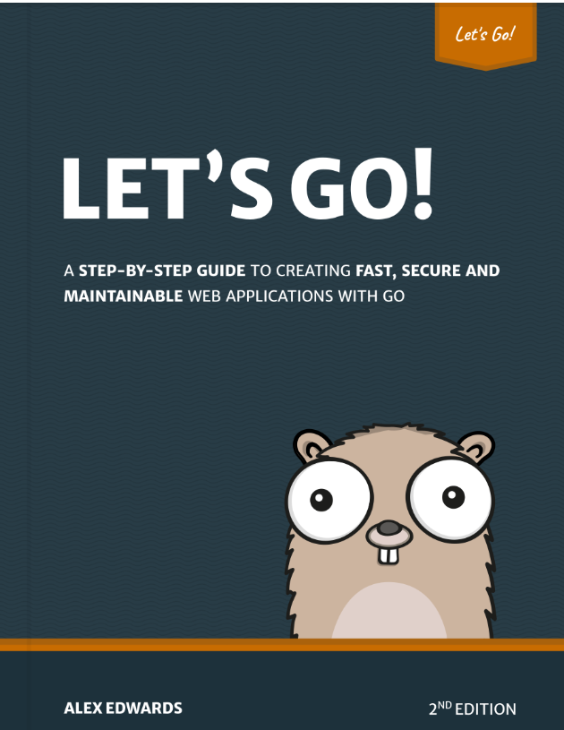

# Final Project of "Let's Go!" by Alex Edwards.



#### Excellent book to get started with web programming in Go .

#### Set up MySQL DB -

```
docker compose up -d
```

#### To delete DB -

docker compose down -v

#### Start server -

```
go run ./cmd/web
```

#### open server in browser -

pay attention that is https server

```
https://localhost:4040/
```

#### My live site -

https://lets.pitron-halomot.org/
